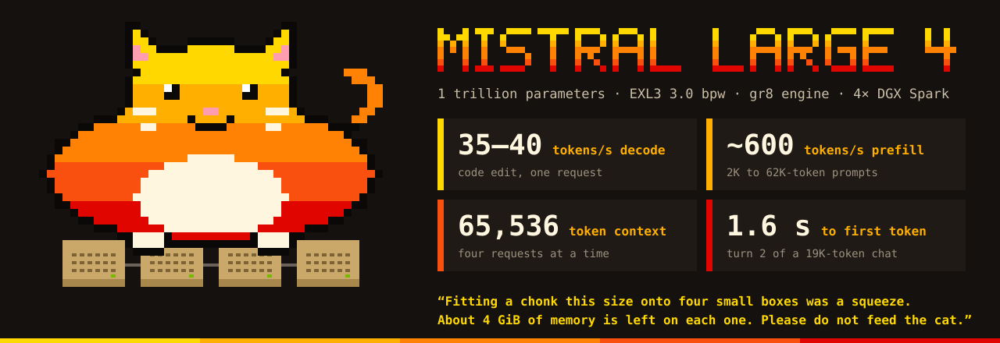

<p align="center"></p>

# Mistral Large 4 on four DGX Sparks with the gr8 engine

This recipe runs **Mistral Large 4** (1 trillion parameters) on **four NVIDIA DGX Sparks**. It gives you an
OpenAI-compatible API on your own hardware. One command does the full installation.

- **Model:** [Mistral-Large-4-1T-A52B](https://huggingface.co/mistralai/Mistral-Large-4-1T-A52B), as the
  [EXL3 3.0 bpw quant](https://huggingface.co/piotrkosecki/Mistral-Large-4-1T-A52B-EXL3-3.0bpw) by Piotr Kosecki.
- **Engine:** [gr8](https://github.com/kindlingai/gr8) at a fixed commit, with the patches in `patches/gr8`.
- **Network:** the four Sparks are connected in a ring with QSFP cables. A network switch is not necessary.

```
  Spark 0 ──── Spark 1
     │            │          Each Spark holds one quarter of the model.
  Spark 3 ──── Spark 2       The API runs on Spark 0.
```

## Performance

All values are measured on four DGX Sparks through the API, with `tools/bench.py`, on a clean install of this
repository. Where two values are given, they are from two different starts: the decode speed changes by some percent
from one start to the next, but the replies stay identical.

| Measurement | Result |
|---|---|
| Decode speed, one request (code edit / prose / new code) | 35 to 40 / 30 / 31 to 34 tokens per second |
| Decode speed at temperature 1 (same prompts) | 36 / 24 / 28 tokens per second |
| Decode speed after a 24,000-token prompt | 20.0 tokens per second |
| Prompt speed (prefill), 2K / 4K / 8K / 16K tokens | 606 / 664 / 621 / 596 tokens per second |
| Prompt speed (prefill), 28K / 48K / 62K tokens | 596 / 569 / 555 tokens per second |
| Time to the first token, short prompt | 0.5 seconds |
| Time to the first token, second turn of a 19,000-token chat | 1.6 seconds |
| Context | 65,536 tokens (prompt and reply together; one pool for all requests that run at the same time) |
| Time to load the model (a full `./start.sh` with its checks: about 1 minute) | 21 seconds |
| Free memory on each Spark while the server runs | 4.0 to 4.6 GiB |
| GPU power for each Spark | about 33 W (decode), about 53 W (prefill) |

**More than one request at the same time.** The engine decodes up to four requests in one step.

| Requests at the same time | Total speed | Speed of each request | Time to the first token |
|---|---|---|---|
| 1 | 27 tokens per second | 29 | 0.5 seconds |
| 2 | 30 tokens per second | 16 | 0.9 seconds |
| 4 | 39 tokens per second | 10.7 | 2.1 seconds |
| 8 (4 run, 4 wait) | 39 tokens per second | 10.4 | 17 seconds |

**Quality.**

- The engine uses the EXL3 weights without changes. The conversion only changes the layout of the data. Each
  converted file is compared with the download before it is used.
- Replies at temperature 0 are identical from one start to the next. Replies with drafts are identical to replies
  without drafts.
- Retrieval: four facts hidden in prompts of 2K to 62K tokens. The model found all four in each of the seven prompt
  sizes.
- Agreement with the full-precision model: on 64 text sequences of 2,048 tokens, the quantized model on this engine
  selects the same most-probable token as Mistral's FP8 release for 92.3% of the tokens (KL divergence 0.124 nats).
- Accuracy on public test sets, through the API at temperature 0 with `reasoning_effort` "low". Four test sets ran
  at the same time. The ± value is one standard error.

| Test set | Questions | Correct | Accuracy |
|---|---|---|---|
| GSM8K (arithmetic word problems) | 250 | 245 | 98.0% ± 0.9 |
| MMLU-Pro (multiple choice, 10 options, all subjects) | 300 | 234 | 78.0% ± 2.4 |
| HumanEval+ (write Python functions, checked with tests) | 164 | 154 | 93.9% ± 1.9 |
| BFCL v3 simple (function calls) | 100 | 89 | 89.0% ± 3.1 |

  For MMLU-Pro, 40 of the 66 incorrect results had no answer: the model was still reasoning at the limit of 2,048
  reply tokens. The model answered 260 questions and 234 of these were correct (90%).

**Limits that you must know.**

- A short request that arrives during a long prompt must wait. Example: a short request sent 2 seconds after a
  24,000-token prompt got its first token after 12.9 seconds.
- The 65,536 tokens of context are one pool. Requests that run at the same time share it; each request does not
  get 65,536 tokens of its own. A request that does not fit waits until an earlier request is complete. Example: two
  prompts of 48,000 tokens sent at the same time were answered one after the other (first tokens after 102 and 199
  seconds), and the two replies were correct.
- Each Spark has only about 4 GiB of memory free while the server runs. Do not run other large programs on the
  Sparks at the same time. A memory guard stops the server before a Spark runs out of memory.
- The API has no password. By default it listens only on Spark 0 itself.

## Requirements

**Hardware**

1. Four DGX Sparks (128 GB each).
2. Four QSFP cables that connect the Sparks in a ring. Connect **port 0 of each Spark to port 1 of the next Spark**.
3. An IPv4 address on each cable port. The two ends of one cable must be in the same subnet, and each cable must
   have its own subnet. See [docs/NETWORK.md](docs/NETWORK.md) for an example.
4. All four Sparks on your usual network (Wi-Fi or Ethernet) with internet access.
5. Free disk space: 900 GB on the Spark where you run the installation (Spark 0), and 130 GB on each other Spark.
   With less disk on Spark 0 (not less than 550 GB), set `CONVERT_JOBS=1`: the conversion then takes about 55 minutes.

**Display Reserved Memory (do this on all four Sparks)**

A DGX Spark keeps 2 GB of memory for the display by default. This recipe needs that memory: with the default
setting, a Spark has too little free memory when the model is loaded. Change the setting to 0.5 GB on each Spark.
All values in this README were measured with 0.5 GB. These steps follow the
[NVIDIA instructions](https://docs.nvidia.com/dgx/dgx-spark/uefi-settings.html#change-display-reserved-memory):

1. Connect a keyboard directly to the Spark. Run `free -h` and write down the total memory.
2. Restart the Spark.
3. Immediately press and hold **Esc** (or **Del**) until the UEFI setup menu appears.
4. Go to **Advanced** → **Advanced Menu** → **Display Reserved Memory**.
5. Select **0.5 GB**. (If you never connect a display, **Auto** gives the same result.)
6. Go to **Save & Exit** and select **Save Changes and Reset**.
7. After the restart, run `free -h` again. The total memory must be larger than before.

**Software and access**

1. The standard DGX OS on each Spark, with Docker and the NVIDIA Container Toolkit (both are installed by default).
2. The same user name on all four Sparks. This user must be in the `docker` group.
3. Login with an ssh key, without a password, from Spark 0 to the other three Sparks. To set this up, run
   `ssh-copy-id <user>@<address>` on Spark 0 for each other Spark.
4. On Spark 0: `git`, `python3`, `rsync`, `curl` and `pipx` (`sudo apt install pipx`).

## Quick start

On one Spark (it becomes Spark 0):

```bash
git clone https://github.com/grubbychicken/mistral-large4-EXL3-4x-DGX-Sparks-gr8
cd mistral-large4-EXL3-4x-DGX-Sparks-gr8
./start.sh
```

You do not need to enter addresses. `start.sh` finds the other three Sparks through the cables and puts them in the
correct order. To check your cluster first without changes, run `DRY_RUN=1 ./start.sh`.

`start.sh` shows each phase in colour: a green ✔ for a step that passed, a yellow ! for a warning, a red ✘ for an
error. Long tasks show a progress bar. If a step fails, correct the cause and run `./start.sh` again. It continues
from the step that failed.

| Phase | What it does | Time on the first start |
|---|---|---|
| 1. Cluster | Finds the four Sparks. Checks Docker, the GPU, memory and disk on each. | 15 seconds |
| 2. Network | Checks that the cables make one ring. Sends full-size pings on each cable. | 5 seconds |
| 3. Engine | Downloads the container image. Gets the gr8 source, applies the patches, builds it. | about 6 minutes + the image download |
| 4. Weights | Downloads the model (403 GB). Converts one quarter for each Spark, checks it, copies it. | download + about 20 minutes |
| 5. Start | Frees memory. Loads the model on the four Sparks. | 25 seconds |
| 6. API | Starts the API. Sends a test request and four sanity checks. | 20 seconds |

Later starts skip the work that is done and take about one minute.

```bash
./status.sh          # the state of the engine and the free memory on each Spark
./stop.sh            # stop the server and free the memory
./start.sh restart   # start again, for example after you change a setting
```

## Use the API

The API follows the OpenAI format. The model name is `mistral-large-4`.

```bash
curl http://127.0.0.1:8000/v1/chat/completions -H 'Content-Type: application/json' -d '{
  "model": "mistral-large-4",
  "messages": [{"role": "user", "content": "Explain what a lighthouse does, in two sentences."}],
  "max_tokens": 300
}'
```

- **From another computer:** by default the API listens only on Spark 0. Open a tunnel with
  `ssh -N -L 8000:127.0.0.1:8000 <user>@<Spark 0>` and use `http://127.0.0.1:8000/v1`. As an alternative, set
  `BIND_HOST=0.0.0.0` to open the API to your network. The API has no password, so do this only on a network that
  you trust.
- **Reasoning:** Mistral Large 4 thinks before it answers. The thinking text arrives in the `reasoning` field and
  the answer in `content`. Set `"reasoning_effort"` in a request to `low` (the default here), `medium` or `high`.
  Give `max_tokens` enough room for the two parts.
- **Use `low` or `medium` effort.** In our use, the model at `high` can think for a very long time before it
  answers, and it sometimes does not reach an answer. This can also occur at `low` with difficult questions: in the
  MMLU-Pro test above, 40 of 300 replies were still thinking at 2,048 tokens.
- **The context limit is strict.** The prompt and `max_tokens` together must be less than 65,536 tokens. If they
  are not, the server refuses the request (HTTP 400) and does not shorten it. Thus, a `max_tokens` of 16,384 leaves
  49,152 tokens for the prompt.
- **Tools, streaming and seeds** work as in the OpenAI API.
- **Chats:** the server keeps the work it did for the earlier turns of a chat. A new turn computes only the new
  tokens.

### Example client settings

Many coding agents and chat programs can use this API. They need the same four facts: the context is 65,536
tokens, one reply must have a limit, the effort levels are `low`, `medium` and `high`, and a long prompt takes time
before the first token arrives (almost two minutes for 62,000 tokens). This example is the model entry that we use
in the `models.yml` file of the OMP coding agent. Use the same values in other programs.

```yaml
providers:
  spark:
    baseUrl: http://<Spark 0>:8000/v1
    api: openai-completions
    auth: none
    compat:
      supportsDeveloperRole: false
      streamIdleTimeoutMs: 900000    # do not stop while the server reads a long prompt
    models:
      - id: mistral-large-4
        name: Mistral Large 4 EXL3 (4x Spark)
        reasoning: true
        input: [text]
        contextWindow: 65536         # prompt and reply together
        maxTokens: 16384             # the limit for one reply; leaves 49,152 tokens for the prompt
        compat:
          supportsReasoningEffort: true
          # the server knows low, medium and high
          reasoningEffortMap: { minimal: low, low: low, medium: medium, high: high, xhigh: high, max: high }
```

## Settings

Put settings in a file named `config.env` in this directory (see `config.env.example`), or export them before
`./start.sh`. All settings and their defaults are in `scripts/config.sh`.

| Setting | Default | Meaning |
|---|---|---|
| `SPARKS` | found automatically | The four Sparks as ssh targets, Spark 0 first, in the order of the ring. |
| `PORT` | `8000` | The port of the API on Spark 0. |
| `BIND_HOST` | `127.0.0.1` | `127.0.0.1`: only Spark 0 can use the API. `0.0.0.0`: your network can use it. |
| `CONTEXT` | `65536` | The largest number of tokens in one request (prompt and reply). It is also the total for all requests that run at the same time. A smaller value frees memory. |
| `SESSIONS` | `4` | The number of requests that run at the same time. More requests wait in a queue. |
| `REASONING_EFFORT` | `low` | The default when a request does not set `reasoning_effort`. |
| `MEMGUARD_FLOOR_GIB` | `3` | The memory guard stops the server if a Spark has less free memory than this for 10 seconds. |
| `MODEL_DIR` | `~/.cache/huggingface/local/…` | Where the 403 GB download goes on Spark 0. |
| `CONVERT_JOBS` | `4` | How many quarters Spark 0 converts at the same time (1 to 4). A smaller value needs less disk on Spark 0 and more time. |
| `ML4_DIR` | `ml4-gr8` | The working directory in the home directory of each Spark (engine, converted weights, logs). |
| `HF_TOKEN` | not set | Your Hugging Face token, if Hugging Face asks for one. |

After the first successful start you can delete the 403 GB download (`MODEL_DIR`). Each Spark keeps its converted
quarter (109 GB).

## How it gets this performance

These are the techniques that this recipe uses. [docs/TECHNIQUES.md](docs/TECHNIQUES.md) explains each one, and
[docs/PATCHES.md](docs/PATCHES.md) lists the patch that contains it.

1. **The weights stay compressed.** The model stays at 3 bits per weight in memory. The GPU kernels decode the
   weights while they multiply, so the engine reads less memory for each token. Memory speed is the main limit on
   a DGX Spark.
2. **Four Sparks work as one GPU.** Each Spark holds one quarter of each layer. The Sparks exchange small results
   over the cables with RDMA, many times for each token. The ring needs no switch.
3. **A draft head proposes tokens.** Mistral ships a small draft model with Mistral Large 4. It proposes up to
   three tokens. The full model checks them in one step. The check uses the same arithmetic as normal decoding, so
   the reply is identical. The engine uses fewer drafts when they do not save time.
4. **One GPU program for each step.** The engine records each decode step as a CUDA graph. This removes most of the
   time that the CPU needs to start GPU work.
5. **Attention that scales with long prompts.** Mistral Large 4 selects which earlier tokens each token looks at.
   Each Spark does one quarter of this selection. The cache for earlier tokens uses a compact form, which makes a
   context of 65,536 tokens possible in the memory that is left.
6. **Fast prompt processing.** The engine processes a prompt in blocks of 2,048 tokens, two blocks at a time. It
   groups the tokens by expert and uses the tensor cores of the GPU.
7. **Chats reuse earlier work.** The engine keeps the cache of a finished request. A request that starts with the
   same text computes only the new part.
8. **Several requests in one step.** Up to four requests share each decode step.
9. **Fast start.** The converted weights are stored in the layout that the GPU uses. A Spark reads its 109 GB at
   about 10 GB per second.
10. **Measure, change one thing, prove it.** Each change was accepted only when the replies stayed identical to
    reference replies, or when a quality test showed no loss.

## Benchmarks and checks that you can run

```bash
python3 tools/sanity.py 127.0.0.1 8000        # four short checks: chat, streaming, a tool call, reasoning effort
python3 tools/bench.py                        # all benchmark cells (about 15 minutes)
python3 tools/bench.py decode prefill         # only the cells that you name
```

`tools/bench.py` times everything on the client, so it also works with other OpenAI-compatible servers.
[docs/BENCHMARKS.md](docs/BENCHMARKS.md) explains each cell and how the values in this README were measured.

## If something goes wrong

| Message | What to do |
|---|---|
| `E_DISCOVERY` | `start.sh` did not find four Sparks. Check the cables and the ssh keys, or set `SPARKS` in `config.env`. |
| `E_SSH` | Spark 0 cannot log in to a Spark without a password. Run `ssh-copy-id <user>@<address>`. |
| `E_FABRIC` | A cable problem. The message names the Spark and the port. See [docs/NETWORK.md](docs/NETWORK.md). |
| `E_MEMORY` / `W_RAM` | A Spark does not have enough free memory. Stop other programs. Check Display Reserved Memory. |
| `E_DISK` | Not enough free disk space. The message gives the necessary amount. |
| `E_DOWNLOAD` | The download stopped. Run `./start.sh` again; it continues. |
| `E_BUILD` | The engine build failed. Read `logs/build.log`. |
| `E_START` | An engine stopped during the start. The message shows its last lines. |
| The server stops by itself | Read `logs/memguard.log`. A Spark had too little free memory. |

Logs are in `logs/` in this directory. The engine logs of each Spark are in `~/ml4-gr8/run/` on that Spark.

## Files

```
start.sh  stop.sh  status.sh     the three commands
config.env.example               settings that you can copy to config.env
scripts/                         the steps of start.sh: cluster, engine, weights (pack), serve; the converter
patches/gr8/                     the changes to the gr8 engine for Mistral Large 4
tools/                           sanity.py and bench.py
docs/                            network setup, techniques, patches, benchmarks
```

## Credits and licence

- **Mistral AI** made Mistral Large 4 and its draft head. The weights have the Mistral licence; read it before you
  use the model.
- **Piotr Kosecki** made the EXL3 3.0 bpw quant that this recipe downloads.
- **turboderp** made ExLlamaV3 and the EXL3 format.
- **The gr8 engine contributors** made the engine (MIT licence).
- **MiaAI-Lab** published the DGX Spark recipes from which the ring checks and the memory counting come.

Details are in [CREDITS.md](CREDITS.md) and [NOTICE.md](NOTICE.md). The files of this repository have the Apache
License 2.0; the patches in `patches/gr8` have the MIT licence of gr8.

Made by [@grubbychicken](https://x.com/grubbychicken).
